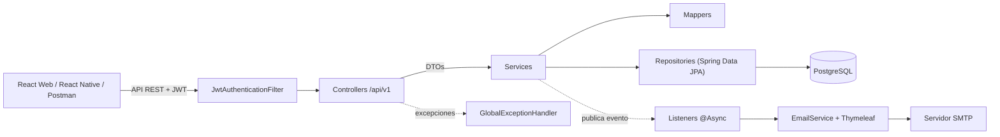
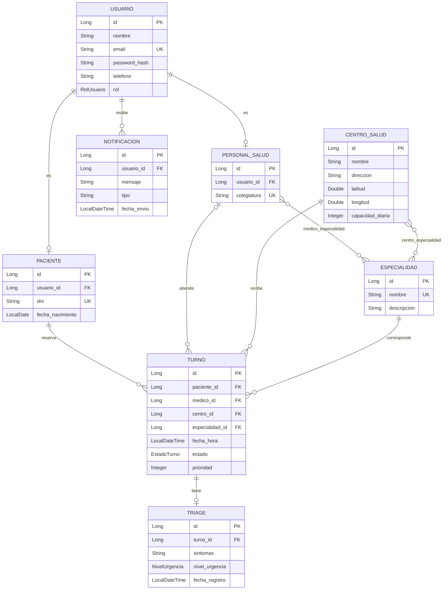

# TurnoYa — Gestión Inteligente de Turnos y Triage para Postas y Centros de Salud

**Curso:** CS2031 — Desarrollo Basado en Plataformas (UTEC, 2026-2)  
**Repositorio:** https://github.com/JohanY2442/Proyecto_TurnoYa_oficial  
**Aplicación web:** https://proyecto-turno-ya-oficial.vercel.app/  
**Backend:** Spring Boot + PostgreSQL (despliegue en AWS EC2/RDS; ver sección de despliegue)  
**Aplicación móvil:** React Native + Expo (código en `mobile/`)

### Equipo activo en la segunda fase

| Integrante | Rol principal |
|---|---|
| **Julian Edison Alvarez Cartolin** | Desarrollo fullstack e integración |
| **Johan Yadir Huayta Enriquez** | Backend y arquitectura de base de datos |

El equipo inicial contaba con cinco integrantes. Tres se retiraron durante el proyecto y **Julián y Yadir continuaron hasta la segunda entrega**. Los aportes y porcentajes de participación de ambos se detallan en [Coevaluación](#coevaluación-de-integrantes--parte-2).

<details>
<summary>Integrantes del equipo original (primera fase)</summary>

| Integrante | Rol registrado originalmente | Situación en la fase 2 |
|---|---|---|
| Leyrin Bridneys Aguilar Jorge | UI/UX y frontend | Retirado/a |
| Julian Edison Alvarez Cartolin | Fullstack e integración | Activo |
| Johan Yadir Huayta Enriquez | Backend y arquitectura de base de datos | Activo |
| Dervy Pillaca Pullo | Backend y procesamiento asíncrono | Retirado |
| Adrián Jesús Ángel Veliz Quispe | DevOps, pruebas y cloud | Retirado |

Los roles originales se mantienen como antecedente histórico; **no representan la coevaluación de la segunda fase**.

</details>

---
## Índice

1. [Introducción](#introducción)
2. [Identificación del problema](#identificación-del-problema)
3. [Descripción de la solución](#descripción-de-la-solución)
4. [Arquitectura y decisiones de diseño](#arquitectura-y-decisiones-de-diseño)
5. [Frontend web (React)](#frontend-web-react)
6. [Aplicación móvil (React Native y Expo)](#aplicación-móvil-react-native-y-expo)
7. [Modelo de entidades](#modelo-de-entidades)
8. [Manejo de errores](#manejo-de-errores)
9. [Medidas de seguridad](#medidas-de-seguridad)
10. [Eventos y asincronía](#eventos-y-asincronía)
11. [GitHub y gestión del proyecto](#github-y-gestión-del-proyecto)
12. [Ejecución local](#ejecución-local)
13. [Despliegue y verificación](#despliegue-y-verificación)
14. [Coevaluación de integrantes — Parte 2](#coevaluación-de-integrantes--parte-2)
15. [Conclusión](#conclusión)
16. [Apéndices](#apéndices)

---

## Introducción

### Contexto

En las postas y centros de salud del Perú, los pacientes suelen hacer fila sin saber cuánto van a esperar. El orden de atención depende casi siempre de la hora de llegada, de modo que un caso urgente puede esperar lo mismo que uno leve.

### Objetivos

- Permitir que el paciente reserve un turno por centro y especialidad desde su celular.
- Registrar un triage rápido de síntomas al llegar y calcular automáticamente su nivel de urgencia.
- Ordenar la cola de atención por prioridad clínica y luego por hora de reserva.
- Notificar al paciente por correo cada cambio importante de su turno.
- Ofrecer una API REST segura, con roles diferenciados para paciente, médico y administrador.

## Identificación del problema

### Descripción

Hoy la espera en una posta es opaca: el paciente no conoce su posición ni el tiempo aproximado de atención. El personal tampoco cuenta con una herramienta simple para priorizar a quien llega con dolor de pecho frente a quien llega con un resfrío.

### Justificación

Priorizar por urgencia reduce el riesgo de que un caso grave se complique en la sala de espera. Además, reservar en línea evita aglomeraciones y ayuda al centro a no superar su capacidad diaria.

## Descripción de la solución

### Funcionalidades implementadas

| Funcionalidad | Cómo ayuda |
|---|---|
| Registro y login con JWT | Cada paciente tiene su cuenta; médicos y administradores tienen permisos distintos. |
| Catálogo de centros y especialidades | El administrador registra los centros con su ubicación, capacidad diaria y especialidades. |
| Búsqueda de centros cercanos | Ordena los centros por distancia a partir de latitud y longitud (fórmula de Haversine). |
| Reserva de turnos | Valida que el centro atienda la especialidad, que queden cupos ese día y que el paciente no tenga otro turno activo. |
| Triage | El paciente elige sus síntomas y el sistema calcula el nivel de urgencia (BAJO, MEDIO, ALTO o CRITICO). |
| Cola por prioridad | El médico ve la cola ordenada y llama al siguiente; el paciente consulta su posición. |
| Notificaciones por correo | Correos HTML de bienvenida, confirmación y cambios de turno, y resultado del triage. |

El nivel de urgencia se calcula con el síntoma más grave (de 1 a 4). Si el paciente reporta tres o más síntomas moderados, el nivel sube un grado.

### Tecnologías utilizadas

| Área | Tecnología |
|---|---|
| Backend | Java 21, Spring Boot 4.1.1, Spring Security, Spring Data JPA, JWT |
| Base de datos | PostgreSQL (producción), H2 (pruebas) |
| Frontend web | React 19, Vite, React Router, axios, Tailwind CSS 4 |
| Bibliotecas web | React Hook Form, Recharts, React Leaflet, OpenStreetMap, react-hot-toast, qrcode.react |
| Aplicación móvil | React Native, Expo SDK 58, Expo Router, axios |
| Funciones móviles | Expo Location, Expo Camera, Expo SecureStore, Expo Notifications, React Native Maps |
| Pruebas y utilidades | Maven Wrapper, JUnit 5, Spring Boot Test, GitHub Actions, Postman |
| Despliegue documentado | Vercel (web), AWS EC2 (API), Amazon RDS (PostgreSQL) |
| Correo | SMTP y plantillas Thymeleaf |

### Endpoints principales

Las rutas del backend usan el prefijo `/api/v1`. La colección `postman_collection.json` en la raíz contiene ejemplos de peticiones para probar la API.

| Método y ruta | Rol |
|---|---|
| `POST /auth/register`, `POST /auth/login`, `POST /auth/refresh` | Público |
| `GET /usuarios/me` | Autenticado |
| `GET /especialidades`, `GET /centros`, `GET /centros/cercanos` | Público |
| `POST, PUT, DELETE /especialidades`, `POST, PUT, DELETE /centros` | ADMINISTRADOR |
| `POST /medicos` | ADMINISTRADOR |
| `GET, PATCH /pacientes/me` | PACIENTE |
| `POST /turnos`, `GET /turnos/me`, `PATCH /turnos/{id}/cancelar` | PACIENTE |
| `POST /turnos/{id}/triage`, `GET /turnos/{id}/posicion` | PACIENTE |
| `GET /centros/{id}/especialidades/{id}/cola` | MEDICO, ADMINISTRADOR |
| `POST /centros/{id}/especialidades/{id}/cola/siguiente` | MEDICO |
| `PATCH /turnos/{id}/estado` | MEDICO, ADMINISTRADOR |

## Arquitectura y decisiones de diseño

### Arquitectura



La API sigue una arquitectura en capas: el filtro JWT identifica al usuario, el controlador valida el DTO, el servicio aplica las reglas de negocio y el repositorio accede a la base de datos. Los correos salen del flujo principal mediante eventos.

### Decisiones de diseño

- **Servicios con interfaz e implementación:** los controladores dependen de la interfaz, lo que facilita las pruebas.
- **DTOs (records) y mappers manuales:** la API nunca devuelve entidades, así no expone datos sensibles ni genera ciclos de serialización.
- **`open-in-view=false` y `JOIN FETCH`:** los servicios convierten a DTO dentro de la transacción, y la cola trae paciente y usuario en una sola consulta, evitando el problema N+1.
- **Prioridad guardada en el turno:** el triage copia su nivel de urgencia al turno, así la cola sale de una sola consulta ordenada sin recalcular nada.
- **Síntomas como enum con gravedad:** la regla de urgencia vive en una sola clase (`CalculadoraUrgencia`), fácil de probar y ajustar.
- **JWT con refresh token:** sin sesiones en el servidor, la API puede escalar; el access token corto limita el daño si se filtra.
- **Nombres del dominio en español:** entidades y reglas usan los términos del personal de salud peruano (turno, triage, colegiatura); los elementos técnicos siguen las convenciones de Spring en inglés (`Controller`, `Service`, `Repository`, `Exception`).

## Frontend web (React)

**Código:** [`web/`](web/)  
**URL pública:** https://proyecto-turno-ya-oficial.vercel.app/

La aplicación web está desarrollada con **React 19 y Vite**, utiliza **React Router** para navegación y consume la API REST del proyecto mediante un cliente centralizado de **axios**. El equipo comprobó el funcionamiento de la aplicación web antes de la entrega.

### Funcionalidades y vistas

| Vista o módulo | Funcionalidad |
|---|---|
| Página de inicio | Presenta TurnoYa y da acceso a la búsqueda de centros y autenticación. |
| Registro e inicio de sesión | Autenticación de usuarios y acceso según rol. |
| Centros de salud | Búsqueda, filtros, ubicación en mapa y detalle del centro. |
| Pacientes | Panel principal, reserva de turnos, triage, consulta de posición y detalle del turno. |
| Médicos | Panel para consultar la cola y gestionar la atención. |
| Administradores | Panel y mantenimiento de centros, especialidades y personas. |
| Perfil | Consulta de información del usuario autenticado. |
| Navegación | Rutas protegidas por rol, páginas de error y ruta 404. |

### Organización, integración y experiencia de usuario

- **`src/routes/router.jsx`:** navegación centralizada, rutas dinámicas (`/centros/:id`, `/turnos/:id`), páginas cargadas con `React.lazy` y rutas protegidas.
- **`src/services/`:** cliente axios único e integración de autenticación, centros, turnos, triage, cola y otros recursos de la API.
- **`src/contexts/` y `src/hooks/`:** estado de sesión y tema visual; hooks de datos, geolocalización, paginación y cola en vivo.
- **`src/components/` y `src/pages/`:** componentes reutilizables, formularios, tablas, mapas, paneles y páginas por rol.
- **Paginación y filtros:** controles en las listas; parámetros de búsqueda, página y tamaño conservados en la URL cuando corresponde.
- **Estados de interfaz:** validación de formularios, avisos de éxito/error, indicadores de carga, confirmaciones y estados vacíos.
- **Cola en vivo:** Server-Sent Events (SSE) con consulta periódica como respaldo si falla la conexión.
- **Interfaz visual:** Tailwind CSS, diseño adaptable, iconos, componentes de uso común y tema claro/oscuro.

La aplicación web utiliza **React Leaflet con OpenStreetMap** para visualizar centros. Las peticiones al backend se configuran con `VITE_API_URL` y los tokens se gestionan mediante los servicios de autenticación del frontend.

## Aplicación móvil (React Native y Expo)

**Código:** [`mobile/`](mobile/)  
**Tecnología:** React Native con Expo SDK 58 y Expo Router.

La aplicación móvil consume el mismo backend del proyecto y contempla flujos para pacientes y médicos. El equipo realizó pruebas funcionales de la app móvil durante el desarrollo. No se incluye aquí una URL de Expo, EAS Update o APK porque no se ha proporcionado un enlace público verificable.

### Funcionalidades móviles

| Módulo | Funcionalidad |
|---|---|
| Autenticación | Registro e inicio de sesión con JWT. |
| Inicio | Centros de salud, búsqueda, mapa y turno activo del paciente. |
| Centros | Consulta de detalles y reserva de turnos. |
| Turnos y triage | Consulta de turnos, registro de síntomas y seguimiento de la atención. |
| Médico | Lectura del código QR del ticket para acceder al turno. |
| Perfil | Consulta y gestión del perfil del usuario. |
| Notificaciones | Avisos locales relacionados con la proximidad del turno. |

### Sensores, mapas y permisos

- **GPS (`expo-location`):** obtiene la ubicación del dispositivo para mostrar centros cercanos. Si se niega el permiso o no hay señal, muestra un mensaje y permite ver el listado general.
- **Cámara (`expo-camera`):** permite al médico escanear el QR del ticket. Si no se puede usar, el código del turno puede introducirse manualmente.
- **Mapas (`react-native-maps`):** representa los centros en el mapa (Google Maps en Android y Apple Maps en iOS).
- **Notificaciones (`expo-notifications`):** avisa al usuario mediante notificaciones locales cuando su turno se aproxima.
- **Sesión:** los tokens se guardan con `expo-secure-store` en dispositivos nativos.

### Organización de `mobile/src/`

```text
src/
├── app/          # Pantallas y rutas de Expo Router
├── components/   # Componentes reutilizables y estados de UI
├── contexts/     # AuthContext
├── hooks/        # Autenticación, datos, ubicación, notificaciones y conexión
├── services/     # API REST, interceptores y almacenamiento de tokens
├── theme/        # Estilos y colores
└── utils/        # Constantes, formateo y mensajes de error
```

### Arquitectura del proyecto completo

```text
Proyecto_TurnoYa_oficial/
├── README.md                 # Documentación general y coevaluación (este archivo)
├── src/                      # Backend Spring Boot (Java)
├── pom.xml                   # Dependencias del backend (Maven)
├── mvnw / mvnw.cmd           # Maven Wrapper
├── postman_collection.json   # Colección para probar la API
├── web/                      # Frontend React + Vite
└── mobile/                   # Aplicación React Native + Expo
```

El backend se encuentra en la **raíz del repositorio**, no en una carpeta llamada `backend/`. Los directorios `web/` y `mobile/` tienen sus propios archivos `README.md` con detalles de cada cliente.

## Modelo de entidades



### Descripción de las entidades

- **Usuario:** base de autenticación para los tres roles (`PACIENTE`, `MEDICO`, `ADMINISTRADOR`). El email es único y la contraseña se guarda cifrada.
- **Paciente** y **PersonalSalud** (médico): perfiles unidos a un usuario mediante `@OneToOne` con `cascade = ALL`, de modo que al guardar el perfil también se guarda su usuario.
- **CentroSalud** y **Especialidad:** se relacionan N:M mediante la tabla `centro_especialidad`. El médico también se relaciona N:M con sus especialidades (`medico_especialidad`).
- **Turno:** entidad central, con relaciones `@ManyToOne` en `LAZY` hacia paciente, médico, centro y especialidad. Su estado avanza entre `RESERVADO`, `EN_ESPERA`, `EN_ATENCION`, `ATENDIDO` y `CANCELADO`, y un índice por centro, especialidad y estado acelera la cola.
- **Triage:** relación 1:1 con el turno. Guarda los síntomas y el nivel de urgencia calculado.
- **Notificacion:** historial de cada correo enviado a un usuario.

Las restricciones se aplican en dos niveles: en la base de datos (`nullable = false`, `unique`, longitudes e índices) y en la aplicación, con Bean Validation en los DTOs (`@NotBlank`, `@Email`, `@Pattern`, `@Past`, `@Min`).

## Manejo de errores

Todas las excepciones propias extienden de `ApiException`, que guarda el código HTTP correspondiente:

| Excepción | HTTP |
|---|---|
| `ResourceNotFoundException` | 404 |
| `DuplicateResourceException`, `TurnoConflictException` | 409 |
| `CentroSinCapacidadException`, `InvalidTriageLevelException`, `InvalidOperationException` | 400 |
| `InvalidCredentialsException`, `TokenExpiredException` | 401 |
| `ForbiddenException` | 403 |
| `NotificationFailedException` | 500 |

`GlobalExceptionHandler` (`@RestControllerAdvice`) también atiende las excepciones de Spring: validación de DTOs, JSON mal formado, parámetros inválidos (400), falta de autenticación (401), falta de permisos (403), ruta inexistente (404), método no permitido (405) e integridad de datos (409). Cualquier otro error devuelve 500 sin exponer detalles internos. Todas las respuestas tienen el mismo formato:

```json
{
  "timestamp": "2026-09-25T10:15:30",
  "status": 404,
  "error": "Not Found",
  "message": "No se encontró el turno con id 45",
  "path": "/api/v1/turnos/45"
}
```

Manejar los errores de forma global evita repetir `try/catch` en cada controlador y garantiza que el frontend reciba siempre una respuesta clara y predecible.

## Medidas de seguridad

### Seguridad de datos

- **Autenticación sin estado con JWT.** El login devuelve un *access token* de 2 horas y un *refresh token* de 7 días. El token incluye `userId`, `email` y `rol`. `JwtAuthenticationFilter` lo valida en cada petición y carga el usuario con un `UserDetailsService` propio.
- **Contraseñas cifradas con BCrypt.** Además se exige una contraseña fuerte: de 8 a 64 caracteres, con mayúscula, minúscula y número.
- **Autorización por roles.** Se usa `@PreAuthorize` en los controladores. Los servicios además verifican la propiedad del recurso: un paciente solo puede ver, cancelar o registrar triage de sus propios turnos (`ForbiddenException`).
- **Secretos fuera del código.** Se leen de variables de entorno.

### Prevención de vulnerabilidades

- **Inyección SQL:** todas las consultas usan Spring Data JPA con parámetros enlazados; nunca se concatenan cadenas SQL.
- **XSS:** la API solo responde JSON, y las plantillas de correo usan `th:text`, que escapa el contenido automáticamente.
- **CSRF:** está desactivado porque la API es *stateless* y no usa cookies de sesión; el token viaja en la cabecera `Authorization`.
- **CORS:** solo se aceptan los orígenes configurados en `CORS_ALLOWED_ORIGINS`.
- **Validación de entrada:** los DTOs usan Bean Validation y los datos inválidos se rechazan con 400.

## Eventos y asincronía

| Evento | Se publica cuando | Qué hace el listener |
|---|---|---|
| `UsuarioRegistradoEvent` | Se registra un paciente o se crea un médico | Envía el correo de bienvenida |
| `TurnoEvent` | Se reserva un turno o cambia su estado | Envía la confirmación o actualización del turno |
| `TriageRegistradoEvent` | El paciente registra su triage | Recalcula la cola y le envía su nivel de urgencia y posición |

Los listeners usan `@TransactionalEventListener(phase = AFTER_COMMIT)`, así que solo actúan cuando los datos ya se guardaron y nunca notifican un turno que terminó en *rollback*. Además usan `@Async`, con un `ThreadPoolTaskExecutor` propio (4 a 10 hilos y cola de 100 tareas).

**¿Por qué asíncronos?** Enviar un correo por SMTP puede tardar varios segundos o fallar. Si se hiciera dentro de la petición, el paciente esperaría más para confirmar su turno y un fallo del servidor de correo rompería la reserva. En segundo plano, la API responde al instante, y si el envío falla solo se registra en los logs. Cada correo enviado queda guardado en `Notificacion`.

## GitHub y gestión del proyecto

- **Flujo de ramas:** cada integrante trabajó en una rama `feature/<nombre>-<tema>` y abrió un Pull Request hacia `master`. La rama `master` está protegida: no acepta *push* directo y requiere la aprobación de otro integrante.
- **Mensajes de commit descriptivos**, en su mayoría con el formato *Conventional Commits* (`feat`, `docs`, `build`).
- **Gestión de tareas:** el equipo dividió el trabajo en un plan por fases. Cada integrante tuvo asignado un módulo (seguridad, catálogo, turnos y triage, eventos, Postman, documentación y despliegue), que desarrolló en su propia rama y entregó mediante un Pull Request. La planificación original correspondió a la primera fase del curso (Semana 7). En la segunda fase continuaron los dos integrantes activos indicados al inicio de este archivo.
- **GitHub Actions:** el flujo `.github/workflows/ci.yml` se ejecuta en cada *push* y en cada Pull Request hacia `master`. Instala Java 21, compila el proyecto y corre los tests; si algo falla, el PR queda marcado en rojo antes de fusionarse.

## Ejecución local

### Requisitos

- **Java 21** y PostgreSQL para el backend.
- **Node.js y npm** compatibles con las versiones del proyecto para web y móvil.
- **Expo Go o emulador compatible** para probar la app móvil (según el SDK configurado).

### 1. Clonar el repositorio y ejecutar el backend

```bash
git clone https://github.com/JohanY2442/Proyecto_TurnoYa_oficial.git
cd Proyecto_TurnoYa_oficial

# Configurar PostgreSQL y las variables de entorno necesarias.
./mvnw spring-boot:run

# Para ejecutar las pruebas:
./mvnw clean test
```

En Windows, usar `mvnw.cmd` en lugar de `./mvnw`. La API corre localmente en `http://localhost:8080`; los endpoints empiezan con `/api/v1`.

**Variables del backend:** `DB_HOST`, `DB_PORT`, `DB_NAME`, `DB_USERNAME`, `DB_PASSWORD`, `JWT_SECRET`, `ADMIN_EMAIL`, `ADMIN_PASSWORD`, `MAIL_USERNAME`, `MAIL_PASSWORD` y `CORS_ALLOWED_ORIGINS`, entre otras. Se configuran en el entorno de ejecución. **No publicar secretos reales ni usar los valores de desarrollo en producción.**

### 2. Ejecutar el frontend web

Desde la raíz del repositorio:

```bash
cd web
npm install
# Crear un archivo .env a partir de .env.example y ajustar VITE_API_URL.
npm run dev
```

La URL local de Vite es habitualmente `http://localhost:5173`. Para crear la versión de producción: `npm run build` (salida en `web/dist/`).

Ejemplo de `web/.env` para desarrollo local:

```dotenv
VITE_API_URL=http://localhost:8080/api/v1
```

### 3. Ejecutar la aplicación móvil

Desde la raíz del repositorio:

```bash
cd mobile
npm install
# Crear un archivo .env a partir de .env.example.
npx expo start
```

Ejemplo de `mobile/.env` (sustituir por la IP de la computadora en la red local):

```dotenv
EXPO_PUBLIC_API_URL=http://192.168.1.20:8080/api/v1
```

En un **celular físico**, `localhost` apunta al propio teléfono. Usar la IP accesible del backend en la red local o la URL de su despliegue. El proyecto contiene `mobile/eas.json` con perfiles de compilación para Expo Application Services (EAS).

## Despliegue y verificación

| Componente | Plataforma / estado documentado | Acceso |
|---|---|---|
| Frontend web | Vercel | https://proyecto-turno-ya-oficial.vercel.app/ |
| Backend REST | AWS EC2; API Java/Spring Boot | `http://3.147.150.111:8080/api/v1` (dirección configurada en `web/vercel.json`; comprobar disponibilidad actual) |
| Base de datos | Amazon RDS for PostgreSQL | Privada; no se publican credenciales |
| Aplicación móvil | React Native + Expo; probada por el equipo | Código en `mobile/`; enlace público de Expo/APK no consignado |

### Integración del despliegue

- El frontend web se distribuye desde Vercel y se conecta a los endpoints de la API REST.
- En el archivo `web/vercel.json` del proyecto se define una reescritura de `/api/v1/*` al backend configurado en AWS EC2.
- El backend utiliza PostgreSQL alojado en Amazon RDS.
- En producción deben configurarse correctamente las variables de entorno, los orígenes CORS y las credenciales fuera del repositorio.
- La web fue abierta y probada por el equipo antes de la entrega. Las pruebas anteriores de la app móvil también fueron satisfactorias; la disponibilidad puede variar con los servicios desplegados.

**Nota sobre las direcciones IP:** la documentación original incluía dos direcciones de EC2 distintas. Se toma como referencia la que figura en la configuración de Vercel del ZIP (`3.147.150.111`). Antes de exponer, verificar si la IP y los servicios siguen operativos.

### Flujo recomendado para demostrar TurnoYa

1. Abrir la web, buscar un centro y revisar su información.
2. Iniciar sesión con un usuario de prueba (sin publicar sus credenciales en este README).
3. Reservar un turno, registrar síntomas y consultar su estado o posición.
4. Mostrar la vista del médico y el flujo de atención del turno.
5. En móvil, mostrar los centros cercanos con GPS y, con una cuenta médica, probar el escaneo del QR.

## Coevaluación de integrantes — Parte 2

La participación se evalúa **individualmente**: un 100 % representa el cumplimiento completo de las responsabilidades de esa persona y **no se reparte** entre los miembros del grupo.

| Integrante | Principales aportes | Participación individual |
|---|---|---:|
| **Julian Edison Alvarez Cartolin** | Desarrollo fullstack, integración entre componentes, pruebas funcionales de la web y la aplicación móvil durante la preparación de la segunda entrega. | **100 %** |
| **Johan Yadir Huayta Enriquez** | Desarrollo de backend y arquitectura de datos, colaboración en la integración del sistema, pruebas funcionales y preparación de la entrega final. | **100 %** |

**Observación:** el grupo inicialmente contó con cinco integrantes. Los otros tres integrantes se retiraron antes de finalizar la segunda fase; Julián y Yadir continuaron participando hasta la entrega final. Los porcentajes anteriores corresponden al cumplimiento de las responsabilidades de **cada integrante activo**. Los roles originales se conservan al inicio del documento únicamente como referencia histórica.

## Conclusión

### Logros

TurnoYa integra backend REST, aplicación web y aplicación móvil para cubrir el flujo de atención: registro, búsqueda de centros, reserva con control de cupos, triage con cálculo de urgencia, consulta de la cola por prioridad y notificaciones. Los flujos de acceso se diferencian por rol de paciente, médico y administrador.

### Aprendizajes clave

- Diseñar relaciones JPA pensando en rendimiento: `LAZY`, índices y consultas con `JOIN FETCH`.
- Configurar Spring Security sin estado con JWT y refresh tokens.
- Usar eventos y asincronía para desacoplar tareas lentas, como el envío de correos, de la respuesta HTTP.
- Trabajar en equipo con ramas, Pull Requests y revisiones de código.

### Trabajo futuro

- Evaluar WebSockets para flujos que requieran comunicación bidireccional; actualmente se emplea SSE con respaldo de consultas periódicas en la web.
- Ampliar canales de notificación, por ejemplo SMS o push remotas.
- Profundizar en métricas de tiempos de atención y estadísticas por establecimiento.
- Completar documentación Swagger/OpenAPI, ampliar las pruebas de integración y fortalecer la observabilidad del despliegue.

## Apéndices

### Licencia

Este proyecto se distribuye bajo la licencia MIT (ver archivo `LICENSE`).

### Referencias

- Spring Boot Reference Documentation: https://docs.spring.io/spring-boot/
- Spring Security Reference: https://docs.spring.io/spring-security/reference/
- Spring Data JPA Reference: https://docs.spring.io/spring-data/jpa/reference/
- JJWT (Java JWT): https://github.com/jwtk/jjwt
- Thymeleaf Documentation: https://www.thymeleaf.org/documentation.html
- GitHub Actions Documentation: https://docs.github.com/actions
